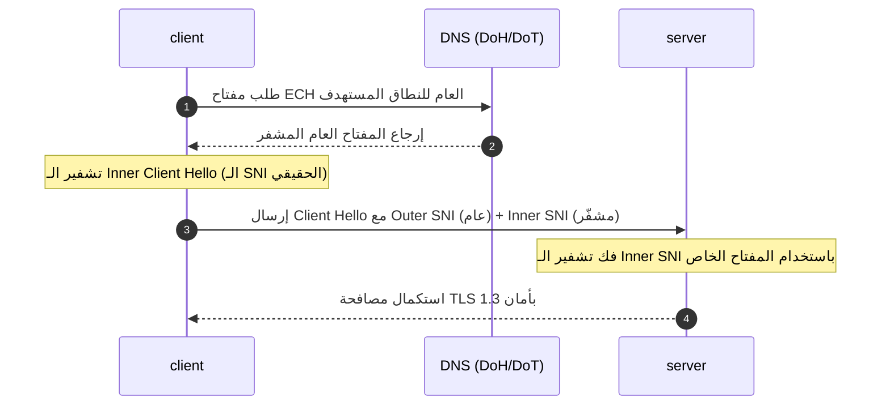

# دراسة نظرية: آليات كشف وتصنيف حركة المرور في الشبكات وحماية الخصوصية المعيارية

تقدم هذه الوثيقة تحليلاً تقنياً ونظرياً للآليات التي تستخدمها أنظمة فحص الحزم العميقة (DPI) للتعرف على حركة مرور الشبكة، بالإضافة إلى استعراض الحلول القياسية والمعيارية المتبعة في هندسة البروتوكولات لحماية خصوصية اسم المضيف (SNI).

---

## 1. آليات كشف وتصنيف حركة مرور الشبكة (Traffic Classification)

تطورت أنظمة كشف الحزم العميقة (DPI) من الاعتماد على الفحص البسيط للعناوين والمنافذ إلى استخدام خوارزميات تحليل سلوكي وإحصائي معقدة.

### أ. التحليل الإحصائي والسلوكي (Statistical & Behavioral Analysis)
حتى في الحالات التي يتم فيها تشفير البيانات بالكامل، يمكن لأنظمة المراقبة استنتاج طبيعة البروتوكول من خلال فحص الخصائص المادية للتدفق:
* **توزيع أحجام الحزم (Packet Size Distribution):** يتم تحليل حجم كل حزمة مرسلة. على سبيل المثال، تمتلك تطبيقات تصفح الويب، وتطبيقات المحادثات الفورية، وأنظمة نقل الملفات (FTP) بصمات أحجام مختلفة تماماً عن بعضها.
* **الفواصل الزمنية بين الحزم (Inter-Arrival Time - IAT):** يقيس النظام الوقت الفاصل بين كل حزمة وأخرى. التدفق المستمر بفواصل زمنية منتظمة يشير عادةً إلى أنفاق نقل البيانات أو البث الحي، في حين أن التصفح البشري يتميز بنمط متقطع (سحب البيانات ثم فترة توقف للقراءة).

### ب. فحص بصمات المصافحة (TLS Handshake Fingerprinting)
أداة رئيسية تستخدمها الأنظمة لتحديد هوية البرمجيات التي أنشأت الاتصال:
* **خوارزميات JA3/JA4:** تقوم هذه الخوارزميات بجمع المعلمات غير المشفرة في حزمة `Client Hello` الأولى (مثل إصدارات TLS المدعومة، وقائمة خوارزميات التشفير (Cipher Suites)، والملحقات).
* **كشف التعارض:** إذا كان العميل يرسل اسماً تمويهياً في الـ SNI يشير إلى متصفح شهير مثل Chrome، بينما تظهر بصمة JA3 أن العميل هو مكتبة برمجية مخصصة (مثل Go أو Python)، فإن النظام يصنف هذا الاتصال كنشاط مشبوه ويقوم بحظره تلقائياً.

### ج. كشف عدم تطابق الـ Host والـ SNI (Domain Fronting Detection)
* يعتمد هذا الفحص على مطابقة طبقات الاتصال.
* يقرأ جدار الحماية اسم النطاق الموجود في طبقة TLS (الـ SNI)، ويقارنه بالعنوان الفعلي المستهدف (Destination IP Address). إذا تبين أن عنوان الـ IP لا ينتمي تقنياً إلى البنية التحتية الخاصة بالنطاق المعلن عنه، يتم الكشف عن محاولة التمويه.

---

## 2. الحلول القياسية لحماية اسم المضيف (SNI Privacy Solutions)

في مواجهة آليات الكشف المتقدمة، وضعت منظمة هندسة الإنترنت (IETF) معايير بروتوكولية لحماية خصوصية بيانات الاتصال في الطبقات الأولى:

### أ. تشفير ترويسة العميل (Encrypted Client Hello - ECH)
يعتبر ECH الملحق المعياري الأحدث في بروتوكول TLS 1.3 لحل مشكلة وضوح اسم المضيف (SNI) في بداية الاتصال:
1. **جلب المفتاح:** يحصل العميل على المفتاح العام للخادم المستهدف عبر سجلات الـ DNS المؤمنة باستخدام بروتوكولات مثل DNS-over-HTTPS (DoH).
2. **التغليف الثنائي:** ينشئ العميل ترويستين للمصافحة:
   - **Outer Client Hello:** تحتوي على اسم مضيف عام ومسموح به غير مثير للريبة (Outer SNI).
   - **Inner Client Hello:** تحتوي على اسم المضيف الفعلي المستهدف وتكون مشفرة بالكامل باستخدام المفتاح العام الذي تم جلبه.
3. **المعالجة في الخادم:** يستقبل الخادم الحزمة، ويفك تشفير الجزء الداخلي (Inner) باستخدام مفتاحه الخاص لاستكمال الاتصال بالوجهة المطلوبة بأمان.

### ب. استخدام شبكات التوصيل السحابية المشتركة (Anycast CDNs)
* يساهم استخدام شبكات التوصيل السحابية الكبرى (مثل Cloudflare أو Fastly) في حماية الخصوصية، حيث تتشارك آلاف المواقع المختلفة نفس عناوين الـ IP (Anycast IPs).
* هذا الاشتراك يجعل من الصعب على جدران الحماية حظر IP معين بناءً على الشكوك، لأن حظره قد يؤدي إلى تعطيل آلاف الخدمات والمواقع الحيوية الأخرى التي تعمل على نفس العنوان.
